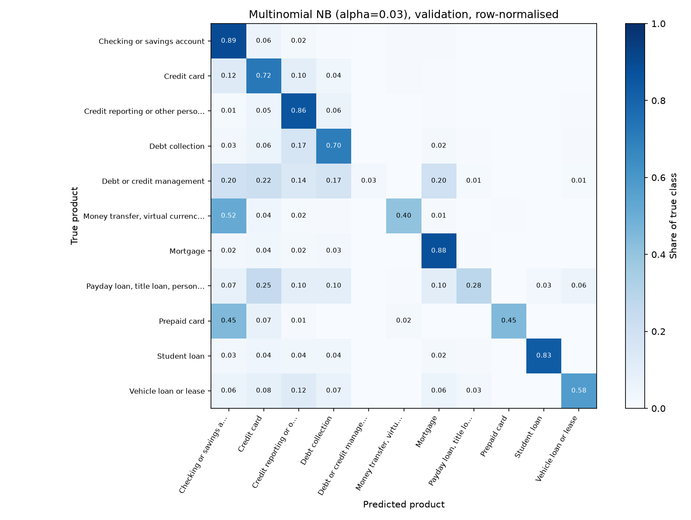

# Milestone 3 Technical Memo: Baseline Reproduction
**Team 32 (KASS Tech), CSCI 3052** · Kevin Thomas, Alex Facey, Subangan Sundaralingam, Sayon Kirubaharan  
**Release:** `v0.3-m3` · **Date:** 2026-10-19

## 1. Pipeline and reproducible environment
The pipeline runs end to end from the repository: raw CFPB CSV → cleaning and duplicate grouping (97,655 distinct complaints, 11 classes) → stratified, group-aware 70/15/15 split (seed 42) → TF-IDF fit on train only → models → tables, figure and logs. `make m3` (or the four `python` commands in the README) runs the tests, the baseline, the discrepancy analysis and the reproducibility check in about 2.5 minutes on a laptop CPU. Package versions are pinned in `requirements.txt` (Python 3.14.5, scikit-learn 1.9.1). `scripts/08_check_reproducible.py` re-runs the baseline and confirms every metric is identical (max difference 0.0); it also records package versions and split-file hashes in `results/logs/repro_check.json`. 23 tests pass: the 12 split-leakage tests from M2 plus 11 new ones (metrics, benchmark reproducibility, train-only TF-IDF fitting, Naive Bayes correctness, bootstrap).

## 2. Baseline table
Validation split (n = 14,649); the test split is sealed until M5. One fixed TF-IDF setting: 1–2-grams, 10,000 features, no stop-word removal, sublinear TF. Mean ± std over seeds 42–44 (Naive Bayes is deterministic, so its std is 0). The 95% CI is a 1,000-resample bootstrap.

| Model | Macro F1 | 95% CI | Accuracy | Weighted F1 |
|---|---|---|---|---|
| Majority class (naive) | 0.062 ± 0.000 | 0.061–0.062 | 0.513 | 0.348 |
| Stratified Random (naive benchmark) | 0.092 ± 0.002 | 0.089–0.098 | 0.306 | 0.306 |
| Multinomial NB, alpha = 1 (default) | 0.516 ± 0.000 | 0.505–0.528 | 0.769 | 0.757 |
| **Multinomial NB, alpha = 0.03 (course-level baseline)** | **0.623 ± 0.000** | **0.609–0.637** | **0.787** | **0.785** |

Alpha was chosen from {0.001, 0.01, 0.03, 0.1, 0.3, 1} by validation Macro F1, so the tuned row is slightly optimistic. It beats Stratified Random by +0.530 Macro F1 (paired bootstrap 95% CI 0.515–0.544; McNemar p < 0.001). The confusion matrix below (rows normalised, so the diagonal is per-class recall) shows where the baseline fails.

## 3. Discrepancy analysis (expected vs observed)

| Check | Expected | Observed |
|---|---|---|
| Stratified Random Macro F1 / accuracy | 0.091 / 0.305 (closed form) | 0.092 / 0.306 |
| Majority class Macro F1 / accuracy | 0.062 / 0.513 | 0.062 / 0.513 |
| Our NB from the formulas vs scikit-learn | 100% agreement | 100% |
| TF-IDF / NB fit time (M2 estimate) | 19.8 s / 1.30 s | 16.7 s / 0.17 s |
| Val rows with a train near-copy (cosine ≥ 0.8) | 22% (M2 sample) | 22.9% (all val) |
| NB Macro F1 weighted by duplicate-group size | 0.623 | 0.587 |

Both benchmarks land on their closed-form values, so the evaluation code behaves as theory predicts, and a Naive Bayes written directly from the Laplace-smoothing formulas matches scikit-learn on all validation rows. NB over-fits moderately (train 0.705 vs validation 0.623) and rare classes suffer most: *Debt or credit management* recall is 0.03 (69 validation rows), *Payday loan* 0.28, *Money transfer* 0.40, *Prepaid card* 0.45, mostly predicted as *Checking or savings* or *Credit card*, because the class prior and small training vocabularies favour large classes. Near-copies of training complaints are much easier (accuracy 0.93 vs 0.75) yet lift Macro F1 by only 0.03, so leakage does not explain the score. Weighting by group size lowers Macro F1 by 0.036, so the live mix, where templates repeat, is somewhat harder than distinct complaints. M2 over-estimated NB fit time by about 8× because small-subsample timings include fixed overhead. Detail: `docs/M3_DISCREPANCY_SECTION.md`.

## 4. Start / Stop / Continue
**Start**

- Run L2 Logistic Regression and k-NN (cosine, Euclidean) through the same `04` pipeline and table format.
- Run the 12-setting TF-IDF ablation with 3 seeds; report mean ± std and bootstrap CIs.
- Test NB with `fit_prior=False` (uniform class prior) to attack the rare-class recall gap in section 3.
- Show the group-size-weighted score and the near-copy split next to every headline number.

**Stop**

- Treating a score on the validation set used for tuning as final; from M5, final numbers come from one pass over the sealed test split.
- Extrapolating compute from 10,000-row samples; budget from measured full-size times (NB 0.17 s, TF-IDF 16.7 s).
- Typing numbers into documents by hand; every figure is copied from a CSV a script produced.

**Continue**

- Group-aware splits, train-only fitting and a sealed test split.
- Pinned environment, fixed seeds and the automatic reproducibility check before each milestone.
- One branch and one reviewed PR per person; logging AI use in `AI_USE.md`.

## 5. Contributions
Alex: TF-IDF features, Naive Bayes and alpha sweep, `04_run_baseline.py`. Sayon: naive benchmarks, metrics, confusion plot, tests, pinned environment, reproducibility check. Subangan: NB from the formulas, bootstrap and McNemar tests, near-copy analysis, `07_discrepancy.py`. Kevin: integration, README, memo, release. AI use is logged per member in `AI_USE.md`.
