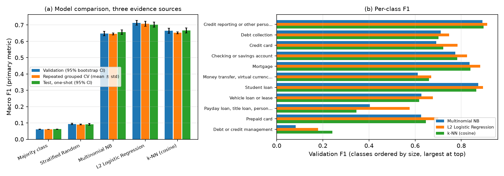
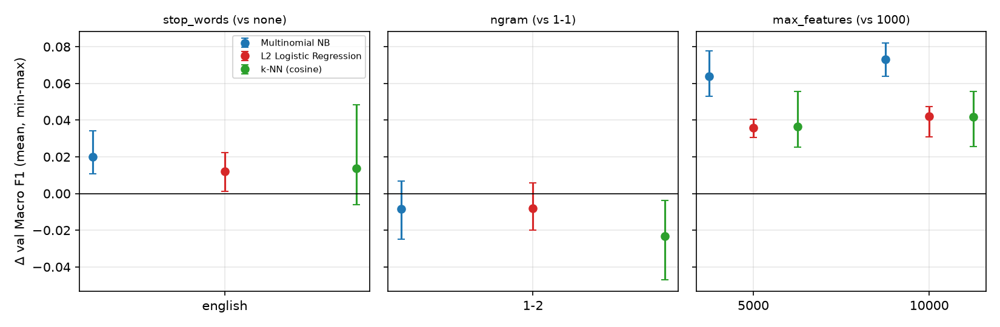
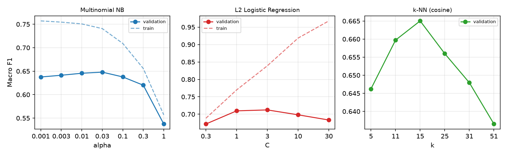
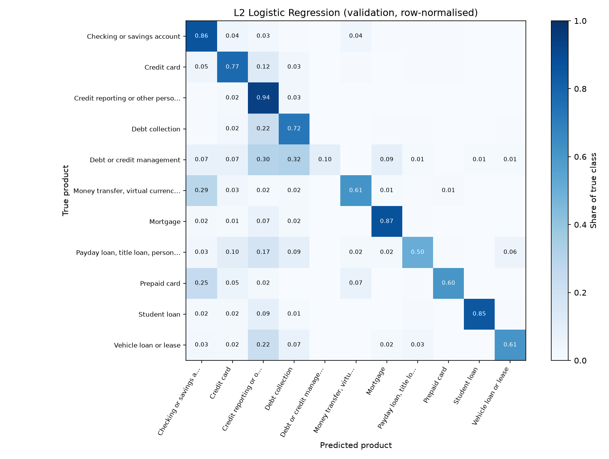

# Results (DRAFT for Milestone 5)

_Numbers are filled from the committed tables by `m5_draft_results.py`. The interpretation sentences marked DRAFT were written from those tables by Kevin with Claude Code; the named owner must check each against the table and be able to defend it. Figures are in `results/figures/`._

## 1. Experimental protocol and fair comparison

All models use the same train/validation/test split (seed 42, group-aware), the same 12 TF-IDF settings fit on train only, the same primary metric (Macro F1, fixed in M2) and selection rule (best validation Macro F1; ties to the faster fit). Test was scored once, after the configurations were frozen.

Configurations searched per model: {'nb': 168, 'lr': 120, 'knn': 144}.

Selected configurations (validation):

- Multinomial NB: TF-IDF {'stop_words': 'english', 'ngram_range': [1, 2], 'max_features': 10000, 'sublinear_tf': True}, hyper-parameters {'alpha': 0.03, 'fit_prior': True}, val Macro F1 0.6480
- L2 Logistic Regression: TF-IDF {'stop_words': 'english', 'ngram_range': [1, 2], 'max_features': 10000, 'sublinear_tf': True}, hyper-parameters {'C': 3.0, 'class_weight': None}, val Macro F1 0.7124
- k-NN (cosine): TF-IDF {'stop_words': None, 'ngram_range': [1, 1], 'max_features': 10000, 'sublinear_tf': True}, hyper-parameters {'k': 15, 'weights': 'distance'}, val Macro F1 0.6650

## 2. Main result

| Model | Val Macro F1 | Val 95% CI | CV Macro F1 (mean ± std) | Test Macro F1 | Val accuracy | Val macro P | Val macro R | Selected configuration |
|---|---|---|---|---|---|---|---|---|
| Majority class | 0.062 | [0.061, 0.062] | 0.062 ± 0.000 | 0.062 [0.061, 0.062] | 0.513 | 0.047 | 0.091 | - |
| Stratified Random | 0.094 | [0.089, 0.098] | 0.090 ± 0.002 | 0.092 [0.087, 0.096] | 0.309 | 0.094 | 0.094 | - |
| Multinomial NB | 0.648 | [0.634, 0.662] | 0.646 ± 0.006 | 0.657 [0.642, 0.671] | 0.805 | 0.755 | 0.629 | 1-2g, 10000 feat, stop=english; alpha=0.03, fit_prior=True |
| L2 Logistic Regression | 0.713 | [0.698, 0.728] | 0.708 ± 0.016 | 0.703 [0.687, 0.717] | 0.846 | 0.806 | 0.677 | 1-2g, 10000 feat, stop=english; C=3.0, class_weight=None |
| k-NN (cosine) | 0.665 | [0.649, 0.680] | 0.653 ± 0.006 | 0.667 [0.651, 0.682] | 0.818 | 0.788 | 0.613 | 1-1g, 10000 feat, stop=no; k=15, weights=distance |

**Question.** Does any model beat the naive benchmarks and the M3 NB baseline?  
**Approach.** Equal-effort grid search on validation; headline numbers with 95% bootstrap CIs.  
**Result.** Validation Macro F1: Majority class 0.062, Stratified Random 0.094, Multinomial NB 0.648, L2 Logistic Regression 0.713, k-NN (cosine) 0.665.  
**What this supports / does not support.** DRAFT (Alex): L2 Logistic Regression is the best model on validation (0.713, 95% CI [0.698, 0.728]) and on the one-shot test (0.703, [0.687, 0.717]). k-NN (0.665 val, 0.667 test) and NB (0.648, 0.657) are lower and their intervals overlap. All three are far above Stratified Random (0.094) and Majority class (0.062). Validation-to-test gaps are small (LR +0.010, NB -0.009, k-NN -0.002), so tuning on validation did not visibly overfit, but the validation numbers are still optimistic by construction. This supports 'a tuned linear model beats the other two on this split'; it does not show the ranking holds in other months or with other features.

## 3. Uncertainty

| label | mean | std_over_folds | min | max | n_runs |
|---|---|---|---|---|---|
| Majority class | 0.0616 | 0.0000 | 0.0616 | 0.0616 | 5 |
| Stratified Random | 0.0905 | 0.0022 | 0.0886 | 0.0939 | 5 |
| Multinomial NB | 0.6456 | 0.0060 | 0.6376 | 0.6533 | 5 |
| L2 Logistic Regression | 0.7078 | 0.0156 | 0.6905 | 0.7326 | 5 |
| k-NN (cosine) | 0.6527 | 0.0060 | 0.6440 | 0.6581 | 5 |

**Question.** How stable is Macro F1 under a different draw of the data?  
**Approach.** Repeated 5-fold StratifiedGroupKFold on train+val (test excluded), frozen configs.  
**Result.** See table above; fold-to-fold std compared with the gaps between models.  
**What this supports / does not support.** DRAFT (Sayon): Over 5 grouped folds (one repeat; the second repeat was dropped for time, see the log) LR scores 0.708 +/- 0.016, k-NN 0.653 +/- 0.006 and NB 0.646 +/- 0.006. LR's lead of about 0.055 to 0.062 is several fold-standard-deviations, so LR > {k-NN, NB} is stable; k-NN vs NB (0.007) is about one standard deviation and cannot be separated. The pool contains the validation rows on which the configurations were chosen, so CV scores are slightly optimistic, and the folds are not independent draws of new data.

Pairwise tests on validation (paired bootstrap of Macro F1 difference, McNemar, Holm-adjusted):

| A | B | macro_f1_diff | ci_low | ci_high | p_bootstrap_holm | mcnemar_p_holm |
|---|---|---|---|---|---|---|
| k-NN (cosine) | L2 Logistic Regression | -0.0483 | -0.0623 | -0.0346 | 0.0060 | 0.0000 |
| k-NN (cosine) | Multinomial NB | 0.0170 | 0.0026 | 0.0318 | 0.0190 | 0.0000 |
| k-NN (cosine) | Stratified Random | 0.5713 | 0.5539 | 0.5867 | 0.0060 | 0.0000 |
| L2 Logistic Regression | Multinomial NB | 0.0653 | 0.0516 | 0.0795 | 0.0060 | 0.0000 |
| L2 Logistic Regression | Stratified Random | 0.6196 | 0.6033 | 0.6354 | 0.0060 | 0.0000 |
| Multinomial NB | Stratified Random | 0.5542 | 0.5392 | 0.5686 | 0.0060 | 0.0000 |

**Question.** Are the model differences larger than resampling noise?  
**Approach.** Paired bootstrap (2000 resamples) + McNemar, Holm-corrected over 6 pairs.  
**Result.** See table.  
**What this supports / does not support.** DRAFT (Subangan): LR beats NB (+0.065 validation, CI [0.052, 0.080]; +0.046 test, [0.033, 0.060]) and k-NN (+0.048 validation, [0.035, 0.062]; +0.036 test, [0.020, 0.052]); all Holm-adjusted p = 0.006. k-NN vs NB is not a stable difference: +0.017 on validation (CI [0.003, 0.032]) but +0.010 on test (CI [-0.006, 0.025], Holm p = 0.21). McNemar (accuracy-type) is significant for that pair on both splits, which shows the two models make different errors while Macro F1 does not separate them. These intervals describe resampling noise on one split, not drift over time.

## 4. Ablation and sensitivity

| model | factor | level | reference | mean_diff | min_diff | max_diff |
|---|---|---|---|---|---|---|
| nb | stop_words | english | none | 0.0201 | 0.0107 | 0.0341 |
| nb | ngram | 1-2 | 1-1 | -0.0083 | -0.0248 | 0.0069 |
| nb | max_features | 5000 | 1000 | 0.0637 | 0.0531 | 0.0779 |
| nb | max_features | 10000 | 1000 | 0.0732 | 0.0640 | 0.0820 |
| lr | stop_words | english | none | 0.0122 | 0.0013 | 0.0222 |
| lr | ngram | 1-2 | 1-1 | -0.0080 | -0.0200 | 0.0057 |
| lr | max_features | 5000 | 1000 | 0.0359 | 0.0305 | 0.0406 |
| lr | max_features | 10000 | 1000 | 0.0422 | 0.0308 | 0.0473 |
| knn | stop_words | english | none | 0.0138 | -0.0060 | 0.0484 |
| knn | ngram | 1-2 | 1-1 | -0.0233 | -0.0470 | -0.0038 |
| knn | max_features | 5000 | 1000 | 0.0364 | 0.0253 | 0.0555 |
| knn | max_features | 10000 | 1000 | 0.0416 | 0.0257 | 0.0558 |

**Question.** Which design choice (stop words, n-grams, vocabulary size, regularisation, k) matters?  
**Approach.** Paired ablation over the tuning grid; hyper-parameter curves at the selected setting.  
**Result.** See table and figures.  
**What this supports / does not support.** DRAFT (Subangan): Vocabulary size is the largest design effect: going from 1,000 to 10,000 features adds +0.073 (NB), +0.042 (LR) and +0.042 (k-NN) Macro F1, positive in every paired comparison. English stop-word removal adds +0.012 to +0.020 (k-NN range includes negatives). Bigrams do not help: -0.008 for NB and LR (range includes 0, comparable to the CV standard deviation) and -0.023 for k-NN (consistently negative). Hyper-parameter curves show over-fitting at weak regularisation: LR's train F1 rises from 0.839 (C=3) to 0.968 (C=30) while validation falls from 0.712 to 0.683; NB peaks at alpha = 0.03; k-NN peaks at k = 15 and is flat from 11 to 25. The best setting for all models uses 10,000 features, the edge of the grid, so a larger vocabulary was not tested and may help. Effects smaller than about 0.01 (stop words for NB/LR, bigrams for NB/LR) should not be read as real.

## 5. Robustness

**Near-copy subsets**

| subset | n | model | macro_f1 | weighted_f1 | accuracy | macro_precision | macro_recall |
|---|---|---|---|---|---|---|---|
| all val | 14649 | nb | 0.648 | 0.803 | 0.805 | 0.755 | 0.629 |
| all val | 14649 | lr | 0.713 | 0.842 | 0.846 | 0.806 | 0.677 |
| all val | 14649 | knn | 0.665 | 0.809 | 0.818 | 0.788 | 0.613 |
| has near-copy in train | 3352 | nb | 0.656 | 0.928 | 0.928 | 0.678 | 0.656 |
| has near-copy in train | 3352 | lr | 0.713 | 0.951 | 0.953 | 0.799 | 0.672 |
| has near-copy in train | 3352 | knn | 0.704 | 0.947 | 0.948 | 0.769 | 0.667 |
| no near-copy in train | 11297 | nb | 0.643 | 0.765 | 0.768 | 0.752 | 0.623 |
| no near-copy in train | 11297 | lr | 0.708 | 0.810 | 0.815 | 0.800 | 0.673 |
| no near-copy in train | 11297 | knn | 0.658 | 0.770 | 0.780 | 0.786 | 0.608 |

**Template weighting**

| weighting | model | macro_f1 | weighted_f1 | accuracy | macro_precision | macro_recall |
|---|---|---|---|---|---|---|
| unweighted (one row per complaint group) | nb | 0.648 | 0.803 | 0.805 | 0.755 | 0.629 |
| unweighted (one row per complaint group) | lr | 0.713 | 0.842 | 0.846 | 0.806 | 0.677 |
| unweighted (one row per complaint group) | knn | 0.665 | 0.809 | 0.818 | 0.788 | 0.613 |
| weighted by group_size (raw-data view) | nb | 0.611 | 0.830 | 0.840 | 0.755 | 0.629 |
| weighted by group_size (raw-data view) | lr | 0.680 | 0.855 | 0.869 | 0.806 | 0.677 |
| weighted by group_size (raw-data view) | knn | 0.675 | 0.910 | 0.914 | 0.788 | 0.613 |

**Truncated input**

| model | first_n_tokens | macro_f1 | weighted_f1 | accuracy | macro_precision | macro_recall |
|---|---|---|---|---|---|---|
| nb | 10 | 0.513 | 0.698 | 0.710 | 0.606 | 0.471 |
| nb | 25 | 0.598 | 0.770 | 0.775 | 0.749 | 0.572 |
| nb | 50 | 0.621 | 0.790 | 0.793 | 0.702 | 0.602 |
| nb | 100 | 0.641 | 0.799 | 0.802 | 0.749 | 0.622 |
| nb | full | 0.648 | 0.803 | 0.805 | 0.755 | 0.629 |
| lr | 10 | 0.516 | 0.677 | 0.691 | 0.640 | 0.458 |
| lr | 25 | 0.620 | 0.769 | 0.776 | 0.724 | 0.572 |
| lr | 50 | 0.653 | 0.806 | 0.812 | 0.727 | 0.617 |
| lr | 100 | 0.686 | 0.826 | 0.831 | 0.771 | 0.650 |
| lr | full | 0.713 | 0.842 | 0.846 | 0.806 | 0.677 |
| knn | 10 | 0.474 | 0.649 | 0.681 | 0.699 | 0.398 |
| knn | 25 | 0.574 | 0.729 | 0.747 | 0.733 | 0.506 |
| knn | 50 | 0.619 | 0.772 | 0.785 | 0.766 | 0.560 |
| knn | 100 | 0.653 | 0.798 | 0.808 | 0.787 | 0.601 |
| knn | full | 0.665 | 0.809 | 0.818 | 0.788 | 0.613 |

**Training-size curve**

| model | fraction | n_train | macro_f1 | weighted_f1 | accuracy | macro_precision | macro_recall |
|---|---|---|---|---|---|---|---|
| nb | 0.100 | 6830 | 0.581 | 0.780 | 0.787 | 0.691 | 0.560 |
| lr | 0.100 | 6830 | 0.633 | 0.811 | 0.820 | 0.737 | 0.583 |
| knn | 0.100 | 6830 | 0.586 | 0.773 | 0.788 | 0.697 | 0.541 |
| nb | 0.250 | 17085 | 0.615 | 0.792 | 0.797 | 0.779 | 0.592 |
| lr | 0.250 | 17085 | 0.670 | 0.824 | 0.830 | 0.822 | 0.625 |
| knn | 0.250 | 17085 | 0.612 | 0.785 | 0.799 | 0.755 | 0.566 |
| nb | 0.500 | 34176 | 0.630 | 0.798 | 0.801 | 0.687 | 0.612 |
| lr | 0.500 | 34176 | 0.692 | 0.833 | 0.838 | 0.805 | 0.653 |
| knn | 0.500 | 34176 | 0.645 | 0.799 | 0.810 | 0.782 | 0.595 |
| nb | 1.000 | 68357 | 0.648 | 0.803 | 0.805 | 0.755 | 0.629 |
| lr | 1.000 | 68357 | 0.713 | 0.842 | 0.846 | 0.806 | 0.677 |
| knn | 1.000 | 68357 | 0.665 | 0.809 | 0.818 | 0.788 | 0.613 |

**Question.** Is the score driven by near-duplicate complaints, template weighting, or long text?  
**Approach.** Subset / re-weighted / truncated validation scoring of the frozen models.  
**Result.** See tables; figures `m5_truncation.png`, `m5_learning_curve.png`.  
**What this supports / does not support.** DRAFT (Alex): About 23% of validation rows (3,352) have a near-copy in train. They are easier in accuracy (LR 0.953 vs 0.815) but LR's Macro F1 is similar on both subsets (0.713 vs 0.708); k-NN benefits most (0.704 vs 0.658), as expected for a neighbour method. Weighting each row by group_size (the raw-data view) lowers LR to 0.680 and NB to 0.611 but raises k-NN to 0.675, so LR's lead over k-NN almost disappears when templated complaints count fully. Truncating narratives to the first 50 tokens costs LR 0.060, k-NN 0.046 and NB 0.027 Macro F1; at 10 tokens all models are at 0.47 to 0.52. Learning curves are still rising at 100% of training data (LR 0.692 at 50% to 0.713), so more data would likely help, and LR leads at every size. These probes do not cover other time periods or label definitions.

## 6. Error analysis

| product | pred | n | share_of_true_class |
|---|---|---|---|
| Debt collection | Credit reporting or other personal consumer reports | 421 | 0.219 |
| Credit reporting or other personal consumer reports | Debt collection | 259 | 0.034 |
| Credit card | Credit reporting or other personal consumer reports | 190 | 0.124 |
| Money transfer, virtual currency, or money service | Checking or savings account | 133 | 0.288 |
| Credit reporting or other personal consumer reports | Credit card | 120 | 0.016 |
| Vehicle loan or lease | Credit reporting or other personal consumer reports | 78 | 0.223 |
| Credit card | Checking or savings account | 73 | 0.048 |
| Checking or savings account | Credit card | 63 | 0.044 |

| slice | level | n | error_rate | macro_f1 |
|---|---|---|---|---|
| length_bucket | <25 | 1096 | 0.184 | 0.507 |
| length_bucket | 25-49 | 2011 | 0.169 | 0.640 |
| length_bucket | 50-99 | 3199 | 0.158 | 0.691 |
| length_bucket | 100-199 | 4014 | 0.147 | 0.734 |
| length_bucket | 200-399 | 2983 | 0.133 | 0.753 |
| length_bucket | 400+ | 1346 | 0.161 | 0.712 |
| template_size | 1 (unique) | 9990 | 0.192 | 0.717 |
| template_size | 2-5 | 4250 | 0.072 | 0.375 |
| template_size | 6+ | 409 | 0.049 | 0.745 |

**Question.** Where and why do the models fail?  
**Approach.** Top confusions, error by narrative length / template size, hand-coded sample (`error_examples_TO_LABEL.csv`).  
**Result.** See tables.  
**What this supports / does not support.** DRAFT (Kevin): LR misclassifies 2,249 of 14,649 validation complaints (15.4%). The largest confusions are Debt collection -> Credit reporting (421, 22% of debt-collection complaints), Credit reporting -> Debt collection (259), Credit card -> Credit reporting (190, 12%) and Money transfer -> Checking or savings (133, 29%). Debt or credit management is nearly unrecoverable (F1 0.18, recall 0.10 on 69 rows) and Payday/personal loans is weak (F1 0.58); because Macro F1 weights every class equally these small classes hold the score down. Short narratives fail more (18.4% error under 25 tokens vs 13.3% at 200-399), and unique complaints fail far more than templated ones (19.2% vs 4.9-7.2%). All three models are wrong on 9.7% of rows and all right on 72.8%. In a sample of 40 errors from the five largest confusions, a preliminary reading (Claude's, to be confirmed by the team in the `reason` column) labels 28 as topic overlap where both products are plausible, 5 as likely gold-label noise, 5 as unclear or off-topic text and 2 as too short. This suggests much of the error is product-boundary ambiguity rather than model weakness, but it is a 40-row sample from the top confusions only. The top LR terms include company names (experian, equifax, synchrony, mohela, coinbase), so part of the signal is a company shortcut that may not transfer.

## 7. Test result (one-shot)

| label | macro_f1 | macro_f1_ci_low | macro_f1_ci_high | val_macro_f1 | val_minus_test |
|---|---|---|---|---|---|
| Majority class | 0.0616 | 0.0610 | 0.0623 | 0.0616 | -0.0000 |
| Stratified Random | 0.0919 | 0.0872 | 0.0964 | 0.0937 | 0.0018 |
| Multinomial NB | 0.6568 | 0.6418 | 0.6705 | 0.6480 | -0.0089 |
| L2 Logistic Regression | 0.7029 | 0.6866 | 0.7172 | 0.7133 | 0.0104 |
| k-NN (cosine) | 0.6667 | 0.6507 | 0.6822 | 0.6650 | -0.0017 |

## 8. Draft conclusions

DRAFT (Kevin):
- A tuned L2 Logistic Regression is the best of the three models on validation (0.713), 5-fold CV (0.708 +/- 0.016) and the one-shot test (0.703); it beats NB and k-NN with Holm-adjusted p = 0.006 on both splits (sections 2 and 3).
- k-NN and NB are not reliably different in Macro F1 (test difference +0.010, CI includes 0), and all models are far above the naive benchmarks (0.06 to 0.09).
- Vocabulary size and regularisation matter more than n-grams or stop words; the best settings sit at the edge of the vocabulary grid, so the grid should be extended before claiming an optimum.
- Errors concentrate in a few small classes and in the credit-reporting / debt-collection boundary; many look like label ambiguity, so a ceiling below 1.0 is expected with this label set.
- Uncertain: behaviour on other time windows, with non-TF-IDF features, and how much of the signal is company names. Next steps: larger vocabularies, a company-name ablation, merged or re-defined confusable classes, a second CV repeat, and hand-confirmed error coding.

## 9. Draft limitations

DRAFT (all): (1) One time window (April-July 2024) and one test split; results may not transfer to other periods, and CFPB stopped publishing narratives in August 2026. (2) Labels are the product chosen at filing and the boundary between credit reporting and debt collection is blurry, so part of the error is label noise. (3) Near-duplicate removal means scores describe unique complaints; weighted by group_size the ordering of LR and k-NN changes. (4) CV configurations were chosen on validation rows that are inside the CV pool, so CV is slightly optimistic; the CV used one repeat. (5) Only TF-IDF features and three classical models; no neural or pretrained models. (6) Top terms include company names, a shortcut that may not generalise. (7) The best vocabulary size is at the grid edge. (8) No demographic or subgroup fairness analysis is possible because the data has no such fields; consumers who did not opt in to narratives are excluded, which biases the sample. (9) The model is suitable for routing and triage support with human review, not for automatic decisions about a consumer's case.